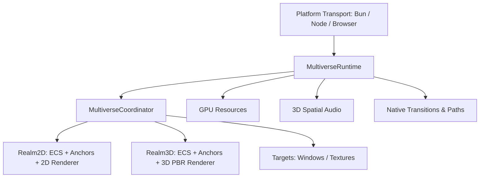

# Galfus Engine: Host Layer Tutorial & Architecture Guide

Welcome to the **Galfus Engine Host Architecture**. This tutorial demonstrates how to use `@galfus/engine` and its unified runtime to coordinate 2D/3D realms, anchor hierarchies, GPU resources, audio, animations, and native frame loops.

---

## 1. Architecture Overview

Galfus Engine separates low-level native/WASM execution from high-level gameplay orchestration:



### Core Concepts:

- **`MultiverseRuntime`**: The primary engine entry point. Connects to the platform transport, manages the precision frame loop (120 FPS or rAF), and steps all subsystems.
- **`MultiverseCoordinator`**: Schedules rendering of multiple independent `Realms` into `Targets` (Windows or Offscreen Textures) through responsive `Invocations`.
- **`Realm2D` & `Realm3D`**: Isolated ECS worlds with built-in anchor hierarchies and automatic native core synchronization.
- **Anchor Hierarchy**: Replaces rigid scene graphs with flexible **Anchors**. Child entities attach to targets via pluggable strategies (`static`, IK, physics chains) while sharing a **persistent, zero-allocation matrix buffer**.

---

## 2. Quickstart: Initialization & Frame Loop

```ts
import { createBunTransport } from '@galfus/transport-bun';
// Alternatively:
// import { createNodeTransport } from '@galfus/transport-node';
// import { createBrowserTransport } from '@galfus/transport-browser';
import { createRuntime } from '@galfus/engine';

// 1. Choose platform transport and create unified runtime
const transport = createBunTransport();
const runtime = createRuntime(transport);

// 2. Initialize platform windowing and GPU subsystem
await runtime.init({ debug: true });

// 3. Register user frame updates (returns an off unsubscription callback)
const offTick = runtime.on('tick', ({ dt, fps, frameId }) => {
  // Game logic updates here
});

// 4. Start the precision frame loop
runtime.start({ targetFps: 120 });
```

---

## 3. Window Creation, Control & Browser Canvas Binding

Before rendering scenes with the Multiverse, you need a display surface. Galfus provides a unified, structured `runtime.platform.window` subsystem that functions consistently across native desktop (Linux, macOS, Windows) and WebAssembly (browsers).

### Window Creation (`runtime.platform.window.create`)

Call `runtime.platform.window.create()` to configure the initial geometry, style, and presentation state. **Window IDs are allocated automatically** and returned as strongly-typed `WindowId` handles:

```ts
// Creates an OS window on desktop, returning a typed WindowId
const windowId = runtime.platform.window.create({
  title: 'Galfus Engine Game', // Window title
  size: [1280, 720], // [width, height] in logical pixels
  position: [100, 100], // Optional initial screen position (desktop)
  resizable: true, // Allow user to resize the window
  decorations: true, // OS border & title bar (false for borderless/kiosk)
  transparent: false, // Transparent background (for widgets or overlays)
  initialState: 'windowed' // 'windowed' | 'maximized' | 'fullscreen' | 'borderlessFullscreen'
});
```

---

### Controlling the Window at Runtime

Once created, windows can be controlled dynamically via the structured `runtime.platform.window` namespace:

```ts
// 1. Update window title
runtime.platform.window.setTitle(windowId, 'Galfus Engine - Level 1');

// 2. Control cursor grab mode ('none' | 'confined' | 'locked'):
//    'locked' enables Pointer Lock for FPS and Orbit cameras with raw mouse delta events
runtime.platform.window.setCursorGrab(windowId, 'locked');

// 3. Update cursor visual appearance ('default' | 'pointer' | 'grab' | 'grabbing' | 'crosshair' | 'text' | 'move' | 'wait')
runtime.platform.window.setCursorIcon(windowId, 'crosshair');

// 4. Query current inner surface size [width, height]
const [width, height] = runtime.platform.window.getSize(windowId);

// 5. Explicitly notify the engine of viewport / swapchain resizing
runtime.platform.window.updateSize(windowId, 1920, 1080);

// 6. Close window and release its OS/GPU surface
runtime.platform.window.close(windowId);
```

---

### Browser Platform: Binding to an HTML `<canvas>`

In WebAssembly/Browser environments, windows are backed by an HTML `<canvas>` element rather than an OS window handle.

#### 1. Setup HTML & CSS

Create a `<canvas>` element with an `id`. Ensure proper CSS styling so the canvas occupies the desired viewport dimensions:

```html
<!-- index.html -->
<!DOCTYPE html>
<html lang="en">
  <head>
    <meta charset="UTF-8" />
    <title>Galfus Web Game</title>
    <style>
      html,
      body {
        margin: 0;
        padding: 0;
        width: 100%;
        height: 100%;
        overflow: hidden;
        background: #000;
      }
      #game-canvas {
        width: 100vw;
        height: 100vh;
        display: block;
      }
    </style>
  </head>
  <body>
    <canvas id="game-canvas"></canvas>
    <script type="module" src="./main.ts"></script>
  </body>
</html>
```

#### 2. Bind the Canvas in TypeScript

Pass `canvasId` matching your HTML element to `runtime.platform.window.create()`. **Galfus automatically observes canvas resizes and manages WebGPU swapchain reconfiguration internally**, so you do not need to set up a manual `ResizeObserver`:

```ts
// main.ts
import { createBrowserTransport } from '@galfus/transport-browser';
import { createRuntime } from '@galfus/engine';

// 1. Initialize browser transport and unified runtime
const transport = createBrowserTransport();
const runtime = createRuntime(transport);
await runtime.init();

// 2. Bind directly to the canvas element using `canvasId`
//    Galfus automatically tracks element dimensions, device pixel ratio, and swapchain sizing
const windowId = runtime.platform.window.create({
  title: 'Galfus Browser Game',
  canvasId: 'game-canvas' // Binds surface directly to <canvas id="game-canvas">
});

// 3. Connect window to Multiverse Target and start game
const targetId = runtime.multiverse.createTarget({ kind: { type: 'window', windowId } });
```

---

### Handling Window & Platform Events (`runtime.on`)

Platform event pumping and swapchain resizing run **100% internally** inside the frame loop. You do not need to poll events or manually forward resize dimensions.

To handle window lifecycle, keyboard, pointer, or gamepad inputs, simply register listeners using `runtime.on()`. Every `.on()` call returns a functional `off()` callback to unsubscribe when no longer needed:

```ts
// 1. Listen to window events (resizing, closing, focus)
const offWindow = runtime.on('window', (event) => {
  switch (event.type) {
    case 'resized':
      // Multiverse swapchain is resized automatically; use this for UI layout or HUD updates
      console.log(`Window ${event.windowId} resized to ${event.width}x${event.height}`);
      break;

    case 'closeRequested':
      console.log('User closed window. Saving state and terminating...');
      runtime.stop();
      runtime.platform.window.close(event.windowId as any);
      break;

    case 'focusChanged':
      console.log(`Window focused: ${event.focused}`);
      break;
  }
});

// 2. Listen to keyboard inputs
const offKeyboard = runtime.on('keyboard', (event) => {
  if (event.type === 'key' && event.state === 'pressed') {
    console.log(`Key pressed: ${event.key}`);
  }
});

// 3. Unsubscribe when needed:
offWindow();

// Or remove all listeners at once:
runtime.clearListeners();
```

---

## 4. Multiverse: Targets & Invocations

The Multiverse can composite multiple 2D and 3D scenes into the same window or render scenes into offscreen textures with **fully automated ID allocation**:

```ts
// 1. Register the window created above as a render target (returns typed TargetId)
const targetId = runtime.multiverse.createTarget({
  kind: { type: 'window', windowId }
});

// 2. Create independent 2D and 3D realms (RealmId assigned automatically)
const realm3D = runtime.createRealm3D();
const realm2D = runtime.createRealm2D();

// 3. Create full-screen 3D viewport invocation (returns typed InvocationId)
const main3DInvocation = runtime.multiverse.createInvocation({
  realmId: realm3D.realmId,
  targetId,
  viewport: { width: { vw: 100 }, height: { vh: 100 } }
});

// 4. Create picture-in-picture (PiP) 2D UI/Minimap overlay
const pip2DInvocation = runtime.multiverse.createInvocation({
  realmId: realm2D.realmId,
  targetId,
  viewport: {
    anchorX: 'right',
    anchorY: 'top',
    offsetX: { px: 20 },
    offsetY: { px: 20 },
    width: { px: 250 },
    height: { px: 250 }
  },
  clearColor: [0, 0, 0, 0.4] // semi-transparent background
});
```

---

## 5. Working with 3D Scenes (`Realm3D`)

### Cams, Lights & PBR Materials

```ts
import { presets3D } from '@galfus/engine/realm3d';

// Perspective Camera
realm3D.createCamera(presets3D.createPerspectiveCamera3DPreset(), {
  position: [0, 5, -12]
});
realm3D.setCameraLookAt(1, { target: [0, 0, 0] });

// Lighting
realm3D.createLight(presets3D.createPointLight3DPreset({ color: [1, 1, 0.9], intensity: 1200 }), {
  position: [5, 10, -5]
});

// PBR Material
const { materialId } = realm3D.createMaterial(
  presets3D.createPbrMaterialPreset({
    baseColor: [0.8, 0.2, 0.3, 1.0],
    roughness: 0.2,
    metallic: 0.8
  })
);
```

### Procedural Primitives & Anchor Hierarchies (`realm3D.hierarchy`)

Entities anchor to parent entities with zero garbage collection allocations. Use `realm3D.hierarchy.attach(origin, target, constraint?)`:

```ts
import { mat4 } from '@galfus/engine';

// 1. Parent Base Entity (e.g. Tank Body)
const parentTank = realm3D.createCube(2.0, materialId, {
  position: [0, 0, 0]
});

// 2. Child Entity (e.g. Turret mounted on top)
const turret = realm3D.createCylinder(0.8, 0.5, 16, materialId, {
  position: [0, 1.25, 0] // Local offset relative to tank
});

// Anchor turret to tank body (static anchor by default)
realm3D.hierarchy.attach(turret, parentTank);

// 3. Child Barrel mounted to Turret
const barrel = realm3D.createCapsule(0.15, 1.5, 4, 16, materialId, {
  position: [0, 0.2, 0.8] // Local offset relative to turret
});
realm3D.hierarchy.attach(barrel, turret);

// 4. Custom constraint callback (Zero-GC, using functional mat4 utilities):
//    e.g. UI indicator follows target position but keeps fixed world orientation:
realm3D.hierarchy.attach(indicator, parentTank, (targetWorld, local, outWorld) => {
  mat4.copy(outWorld, local);
  mat4.copyPosition(outWorld, targetWorld);
});

// 5. Query and detach:
const isAttached = realm3D.hierarchy.isAttached(turret); // true
const children = realm3D.hierarchy.getChildren(parentTank); // [turret.entityId]
realm3D.hierarchy.detach(barrel); // Unlinks barrel from turret
```

### Particles, Portals & Debug Gizmos

```ts
// 3D Particle Emitter
const sparkEmitter = realm3D.createParticleEmitter(
  {
    maxParticles: 500,
    spawnRate: 60,
    startColor: [1, 0.8, 0.2, 1],
    endColor: [1, 0, 0, 0]
  },
  { position: [0, 1, 0] }
);

realm3D.particleEmitterBurst(1, 100);

// Immediate Debug Lines and Bounding Boxes
realm3D.drawLine(0, 0, 0, 0, 10, 0, 0, 1, 0, 1);
realm3D.drawAabb(-1, -1, -1, 1, 1, 1, 1, 0, 0, 1);
```

---

## 6. Working with 2D Scenes (`Realm2D`)

```ts
// Camera & Lighting
realm2D.createCamera({ orthoScale: 1.0 }, { position: [0, 0] });
realm2D.createLight({ color: [1, 1, 1], radius: 300, intensity: 1.0 }, { position: [100, 100] });

// Sprites & Procedural SDF Shapes
realm2D.createSprite({ dimensions: [64, 64] }, { position: [200, 300] });
realm2D.createShape({ kind: 'circle', radius: 32 }, { position: [400, 300] });

// Dynamic Interactive SVG
const hudSvg = realm2D.createSvg(
  {
    source: '<svg><text id="score">Score: 0</text></svg>'
  },
  { position: [20, 20] }
);

// Mutate SVG DOM elements directly at runtime
realm2D.setSvgText(1, 'score', 'Score: 1500');
realm2D.setSvgAttribute(1, 'score', 'fill', '#FFD700');

// Soft Polar SDF Shadows
realm2D.setShadowConfig({ ambient: 0.15, lightRadius: 15 });
```

---

## 7. Shared GPU Resources, Audio & Animations

### Semantic GPU Textures & Geometry

Galfus avoids generic unstructured buffers in favor of **domain-semantic structures**:

```ts
// 1. Upload typed pixel buffer to GPU as a Texture (returns strongly-typed TextureId)
const textureId = runtime.resources.createTexture(
  { width: 256, height: 256, format: 'rgba8unorm' },
  rawPixelBytes
);

// 2. Create custom 3D Geometry directly from semantic vertex & index arrays:
const { geometryId, entityId } = realm3D.createGeometry(
  {
    positions: new Float32Array([-1, 0, 0, 1, 0, 0, 0, 1, 0]),
    normals: new Float32Array([0, 1, 0, 0, 1, 0, 0, 1, 0]),
    uvs: new Float32Array([0, 0, 1, 0, 0.5, 1]),
    indices: new Uint16Array([0, 1, 2])
  },
  materialId // Optionally binds to a Model3DComponent on the created entity
);
```

### High-Frequency 3D Spatial Audio (`runtime.audio`)

Update listener and emitter positions with **direct numerical parameters** (zero-JSON, zero-GC per frame):

```ts
// 1. Load sound bytes into core memory (returns typed SoundId)
const soundId = runtime.audio.loadSound(rawAudioBytes);

// 2. Play stereo sound (returns typed VoiceId)
const voiceId = runtime.audio.playSound(soundId, { volume: 0.8, looping: true });

// 3. Play 3D spatial sound with initial emitter position (returns typed VoiceId)
const spatialVoice = runtime.audio.playSoundSpatial(soundId, [5, 0, 2], {
  volume: 1.0,
  maxDistance: 50
});

// 4. Update spatial positioning per-frame directly without allocating objects:
runtime.onTick(() => {
  // Update listener (typically from main camera position)
  runtime.audio.setListenerPosition(camX, camY, camZ);

  // Update moving sound emitter (e.g. enemy or vehicle position)
  runtime.audio.setVoiceEmitterPosition(spatialVoice, enemyX, enemyY, enemyZ);
});
```

### Native Interpolation & Animations (`runtime.animation`)

All transitions and path followers can be **directly bound to entity properties** across 2D and 3D realms:

```ts
// 1. Animate a 3D Model transform directly via Realm helper:
realm3D.animateModel(
  cubeEntityId,
  { type: 'vec3', value: [10, 5, 0] },
  { duration: 1.5, easing: 'easeOutCubic' },
  runtime.animation
);

// 2. Animate a 2D SVG opacity directly via Realm helper:
realm2D.animateSvgOpacity(svgEntityId, 0.0, 1.0, runtime.animation);

// 3. Create transition explicitly bound to an AnimationTarget:
const transId = runtime.animation.createTransition(
  { type: 'vec3', value: [0, 0, 0] },
  { duration: 2.0 },
  { kind: 'modelTransform3D', realmId: realm3D.realmId, modelId }
);

// 4. Follow declarative SVG-like path motion bound to a 3D camera:
const pathId = runtime.animation.createPathFollow(
  [
    { type: 'moveTo', to: [0, 5, -10] },
    { type: 'lineTo', to: [0, 8, -5], duration: 2.0 },
    { type: 'quadTo', control: [5, 10, 0], to: [10, 5, 0], duration: 1.5 }
  ],
  { duration: 3.5 },
  { kind: 'camera3DTransform', realmId: realm3D.realmId, cameraId }
);

// 5. Listen to animation lifecycle events using runtime.on('animation')
const offAnim = runtime.on('animation', (event) => {
  if (event.eventType === 'completed') {
    console.log(`Transition ${event.transitionId} finished!`);
  }
});
```

---

## 8. Clean Shutdown

Calling `dispose()` cleans up all native pointers, memory allocations, audio voices, and open windows:

```ts
runtime.dispose();
```
